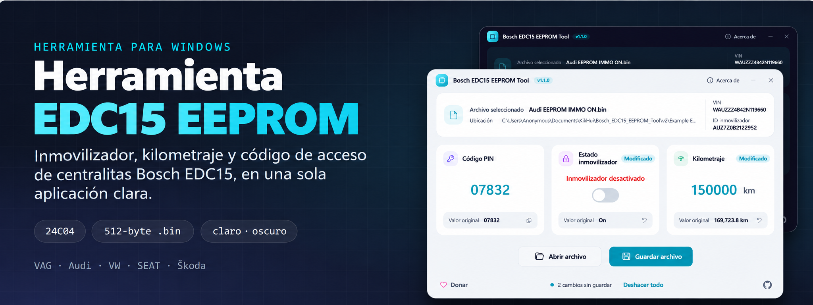

<a id="inicio"></a>

<div align="center">



# Bosch EDC15 EEPROM Tool — Español

**Lee y edita la EEPROM 24C04 de las centralitas diésel Bosch EDC15: inmovilizador, kilometraje y código de acceso.**<br>
Herramienta para Windows destinada a centralitas VAG EDC15 de Audi, Volkswagen, SEAT y Škoda. Permite activar o desactivar el inmovilizador, leer y corregir el kilometraje, y leer o cambiar el código PIN de 5 dígitos en un archivo `.bin` de 512 bytes.

<p>
  <a href="https://github.com/muki01/Bosch_EDC15_EEPROM_Tool/stargazers"></a>
  <a href="https://github.com/muki01/Bosch_EDC15_EEPROM_Tool/network/members"></a>
  <a href="https://github.com/muki01/Bosch_EDC15_EEPROM_Tool/issues"></a>
  <a href="LICENSE"></a>
  <a href="https://github.com/muki01/Bosch_EDC15_EEPROM_Tool/releases"></a>
  <a href="https://github.com/muki01/Bosch_EDC15_EEPROM_Tool/actions/workflows/build.yml"></a>
</p>

**[Características](#caracteristicas) · [Capturas](#capturas) · [Centralitas compatibles](#centralitas-compatibles) · [Compilar](#compilar) · [Uso](#uso) · [Desarrollo](#desarrollo-a-medida)**

</div>

---

## Resumen

**Bosch EDC15 EEPROM Tool** abre un volcado de 512 bytes de una EEPROM 24C04 de una centralita de motor **Bosch EDC15** —montada en numerosos vehículos diésel de Audi, Volkswagen, SEAT y Škoda de finales de los años noventa y principios de los 2000— y muestra el estado del inmovilizador, el kilometraje, el código PIN, el VIN y el identificador del inmovilizador.

Al modificar un dato, queda marcado como cambiado. Al guardar, la herramienta crea un archivo `.bin` nuevo y conserva intacto el original. No hace falta editar hexadecimal: la herramienta gestiona las posiciones, las copias duplicadas y las validaciones.

<a id="caracteristicas"></a>

## Características

- 🔐 **Inmovilizador** — actívalo o desactívalo; se escriben juntas las dos copias del dato.
- 🔢 **Kilometraje** — consulta el valor almacenado y corrígelo. Se actualizan las dos copias y se conservan los bits reservados.
- 🔑 **Código PIN** — lee, copia o cambia el código de 5 dígitos (`0XXXX`) usado en la programación de llaves y adaptaciones.
- 🚗 **Datos del vehículo** — muestra el VIN y el identificador del inmovilizador guardados en el volcado.
- 🏷️ **Deshacer cambios** — cada valor modificado se puede restaurar por separado; **Deshacer todo** restaura todos los valores.
- ✅ **Validaciones** — rechaza archivos que no tengan 512 bytes y avisa si detecta datos inusuales, copias distintas o un código fuera de rango.
- ↩️ **Edición segura** — solo escribe los valores que cambias, valida mientras escribes y no sobrescribe el original salvo que elijas expresamente ese archivo.
- 🌗 **Tema claro y oscuro** — sigue el tema de Windows y cambia al instante.
- 🖱️ **Atajos** — arrastra el volcado a la ventana; `Ctrl+O` para abrir, `Ctrl+S` para guardar y `F1` para ver información.

<a id="capturas"></a>

## Capturas

Las capturas alternan entre tema claro y oscuro según el tema de GitHub. La aplicación sigue la configuración de Windows.

<table>
<tr>
<td align="center" width="50%">
<picture><source media="(prefers-color-scheme: dark)" srcset="images/screenshots/dark/start.png"></picture>
<br><b>Inicio</b><br><sub>Abre un archivo o arrástralo a la ventana</sub>
</td>
<td align="center" width="50%">
<picture><source media="(prefers-color-scheme: dark)" srcset="images/screenshots/dark/edited.png"></picture>
<br><b>Edición</b><br><sub>Los valores modificados se marcan y se pueden restaurar por separado</sub>
</td>
</tr>
<tr>
<td align="center">
<picture><source media="(prefers-color-scheme: dark)" srcset="images/screenshots/dark/invalid.png"></picture>
<br><b>Validación</b><br><sub>La aplicación explica los datos incorrectos y bloquea el guardado</sub>
</td>
<td align="center">
<picture><source media="(prefers-color-scheme: dark)" srcset="images/screenshots/dark/about.png"></picture>
<br><b>Acerca de</b><br><sub>Funciones de la herramienta y precauciones</sub>
</td>
</tr>
</table>

<a id="centralitas-compatibles"></a>

## Centralitas compatibles

La herramienta está diseñada para centralitas VAG EDC15 que utilicen una EEPROM 24C04 de 512 bytes. En estas unidades, las posiciones del inmovilizador, el kilometraje y el código PIN comparten la misma estructura.

| Parámetro | Compatibilidad |
| :-- | :-- |
| **Fabricante** | Bosch |
| **Familia de centralitas** | EDC15P, EDC15P+, EDC15VM+ (variantes VAG) |
| **Vehículos** | Audi, Volkswagen, SEAT y Škoda |
| **Memoria** | EEPROM serie 24C04, 512 bytes |

> [!IMPORTANT]
> **Comprueba que el volcado es compatible.** El archivo debe medir exactamente **512 bytes** (24C04). Si la herramienta indica que no reconoce el inmovilizador o el código PIN no tiene el formato `0XXXX`, o muestra el VIN como «No encontrado», probablemente se trata de otra estructura de centralita: no guardes el archivo. No son compatibles las EDC15 con EEPROM **95040 / 95080 / 95160** ni las EDC15 de otras marcas (Renault, Volvo, Ford, etc.).

<details>
<summary><b>Estructura de la EEPROM (detalles técnicos)</b></summary>

<br>

Las posiciones corresponden al volcado de 512 bytes. Cada valor editable aparece dos veces: la herramienta lee la primera copia y escribe ambas.

| Valor | Principal | Copia | Notas |
| :-- | :-- | :-- | :-- |
| Código PIN | `0x12E–0x12F` | `0x160–0x161` | Little-endian; se muestra como `0XXXX` |
| Inmovilizador | `0x1B0` | `0x1DE` | `0x73` = activado, `0x60` = desactivado |
| Kilometraje | `0x1BF–0x1C2` | `0x1ED–0x1F0` | 28 bits, valor = km × 100; el nibble alto del último byte está reservado |
| VIN | `0x140` | — | 17 caracteres ASCII; solo lectura |
| Identificador del inmovilizador | `0x131` | — | 14 caracteres; solo lectura |

</details>

<a id="compilar"></a>

## Compilar desde el código fuente

Requisitos: Windows con [.NET SDK](https://dotnet.microsoft.com/download) 9 o posterior, o Visual Studio 2022 (17.12+) con la carga de trabajo *Desarrollo de escritorio de .NET*. El programa se compila para **.NET Framework 4.8**, incluido en Windows 10 y 11, así que quien lo use no necesita instalarlo.

```bash
git clone https://github.com/dewasha40/Bosch_EDC15_EEPROM_Tool-spanish.git
cd Bosch_EDC15_EEPROM_Tool-spanish

dotnet build -c Release          # compilar
dotnet test                      # ejecutar las pruebas
dotnet run --project src/Edc15EepromTool
```

Para generar el ejecutable:

```bash
dotnet publish src/Edc15EepromTool -c Release -o publish
```

El resultado es `publish/EDC15 EEPROM Tool.exe`, un único archivo de unos 110 KB.

### Estructura del proyecto

```text
Bosch_EDC15_EEPROM_Tool-spanish/
├── src/Edc15EepromTool/
│   ├── Core/              Edc15Eeprom: lectura y escritura del volcado
│   ├── ViewModels/        Estado y comandos de la ventana
│   ├── Themes/            Paletas claras y oscuras y estilos
│   └── MainWindow.xaml    Interfaz de usuario
├── tests/                 Pruebas unitarias con los volcados de ejemplo
└── Example EEPROM Files/  Volcados de referencia
```

<a id="uso"></a>

## Uso

1. **Abrir** — arrastra el volcado de 512 bytes a la ventana o pulsa **Abrir archivo**.
2. **Revisar** — comprueba el inmovilizador, el kilometraje, el código PIN y los datos del vehículo. Se avisará si algo parece inusual.
3. **Editar** — cambia el inmovilizador, escribe un kilometraje o un código PIN. Los valores modificados quedan marcados y se pueden restaurar por separado.
4. **Guardar** — pulsa **Guardar archivo** para crear otro archivo `.bin`.

## Colaborar

Se agradecen informes de centralitas probadas, errores, correcciones y mejoras de documentación. Lee primero la [guía para contribuir](CONTRIBUTING.md) y el [código de conducta](CODE_OF_CONDUCT.md).

**¿Lo has probado con tu centralita?** Abre un [informe de compatibilidad](https://github.com/dewasha40/Bosch_EDC15_EEPROM_Tool-spanish/issues/new/choose) e incluye la referencia Bosch y el vehículo. No publiques volcados: contienen el VIN, el identificador del inmovilizador y el código PIN del vehículo. Los problemas de seguridad se deben comunicar según la [política de seguridad](SECURITY.md), no en una incidencia pública.

## Proyectos relacionados

La herramienta forma parte de una familia de proyectos automotrices de código abierto de [Muki](https://github.com/muki01).

| Proyecto | Descripción |
| :-- | :-- |
| [BMW I-Bus / K-Bus Firmware](https://github.com/muki01/BMW_IBus_KBus) | Control desde el móvil y funciones de iluminación con el mando para BMW E46, ESP32 y Arduino. |
| [OBD2 K-Line Reader](https://github.com/muki01/OBD2_K-line_Reader) | Diagnóstico para vehículos K-Line (ISO 9141-2, KWP2000) con panel web para ESP32, ESP8266 y Arduino. |
| [VAG KW1281](https://github.com/muki01/VAG_KW1281) | Diagnóstico KW1281 para VW, Audi, Škoda y SEAT: datos de ECU, grupos de medición y códigos de avería. |
| [Biblioteca OBD2 K-Line](https://github.com/muki01/OBD2_KLine_Library) | Diagnóstico K-Line mediante ISO 9141-2, KWP2000, KW1281, DS2 y KW82. |
| [Biblioteca OBD2 CAN Bus](https://github.com/muki01/OBD2_CAN_Bus_Library) | Diagnóstico OBD-II por ISO 15765-4 con el controlador CAN integrado del ESP32. |
| **Bosch EDC15 EEPROM Tool** | Editor del inmovilizador, kilometraje y código PIN para EEPROM 24C04 de Bosch EDC15. |

<a id="desarrollo-a-medida"></a>

## Desarrollo a medida

Diseño herramientas de diagnóstico, firmware y hardware para automoción. Puedo ayudar con un producto completo o con la capa de comunicación.

| Servicio | Detalles |
| :-- | :-- |
| **Implementación de protocolos** | BMW I/K-Bus, K-Line (ISO 9141-2 / KWP2000), CAN / UDS, VAG KW1281 y protocolos específicos de fabricante |
| **Comunicación y análisis de ECU** | Captura de bus, decodificación de paquetes, control de módulos y estructuras EEPROM/flash |
| **Acceso de seguridad a ECU** | Algoritmos seed-key y rutinas de desbloqueo para KWP2000 / UDS |
| **Firmware integrado** | Arduino, ESP32, ESP8266, STM32 y Raspberry Pi Pico |
| **Hardware a medida** | Interfaces de diagnóstico, shields y PCB según los requisitos |
| **Aplicaciones de escritorio y móviles** | Windows, Android, iOS y web para leer, registrar y editar datos del vehículo |

## Contacto

| Canal | Dirección |
| :-- | :-- |
| 📧 **Correo** | [muksin.muksin04@gmail.com](mailto:muksin.muksin04@gmail.com) |
| 💼 **LinkedIn** | [linkedin.com/in/muksin-muksin](https://www.linkedin.com/in/muksin-muksin/) |
| 🐙 **GitHub** | [@muki01](https://github.com/muki01) |

## Apoyar el proyecto

Si este proyecto te ha resultado útil, puedes apoyar su desarrollo:

- [Buy Me a Coffee](https://www.buymeacoffee.com/muki01)
- [Donar con PayPal](https://www.paypal.com/donate/?hosted_button_id=SAAH5GHAH6T72)
- [GitHub Sponsors](https://github.com/sponsors/muki01)

## Historial de estrellas

<a href="https://star-history.com/#muki01/Bosch_EDC15_EEPROM_Tool&Date">
  <picture>
    <source media="(prefers-color-scheme: dark)" srcset="https://api.star-history.com/svg?repos=muki01/Bosch_EDC15_EEPROM_Tool&type=Date&theme=dark">
    
  </picture>
</a>

## Aviso legal y de uso

> [!WARNING]
> Esta herramienta se ofrece **tal cual**, para fines educativos y de reparación de vehículos. Editar datos de una ECU conlleva riesgos y un error puede impedir que el vehículo arranque. **Conserva siempre una copia** del volcado original de 512 bytes. Corrige el kilometraje únicamente para reflejar el cambio de cuadro de instrumentos o de centralita; alterar el kilometraje para engañar a un comprador es ilegal en la mayoría de países. El autor no se responsabiliza de daños en vehículos, centralitas o equipos.

## Licencia

Publicado bajo la [GNU General Public License v3.0](LICENSE).

- Puedes usar, estudiar, modificar y compartir esta herramienta.
- Si la distribuyes, por sí sola o como parte de un producto, debes ofrecer el código fuente completo bajo la misma licencia.

Para integrar la herramienta en un producto comercial de código cerrado, existe una licencia comercial independiente. Contacta con el autor.

Copyright © 2026 Muksin Muksin.

---

<div align="center">

Traducción al español del proyecto de [**Muki**](https://github.com/muki01) · [Repositorio original](https://github.com/muki01/Bosch_EDC15_EEPROM_Tool)

<sub>Bosch EDC15 · EEPROM 24C04 · inmovilizador · kilometraje · código PIN · VAG · Audi · VW · SEAT · Škoda · ECU diésel · WPF · .NET</sub>

**[⬆ Volver al principio](#inicio)**

</div>

